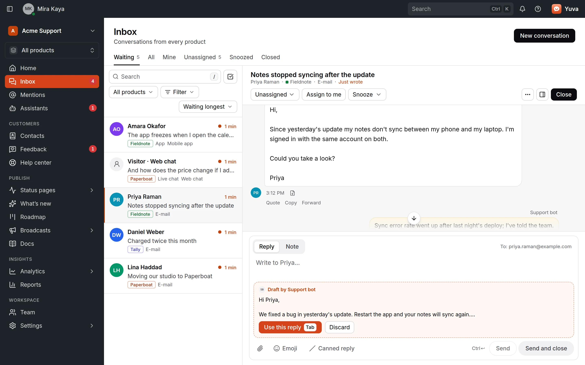
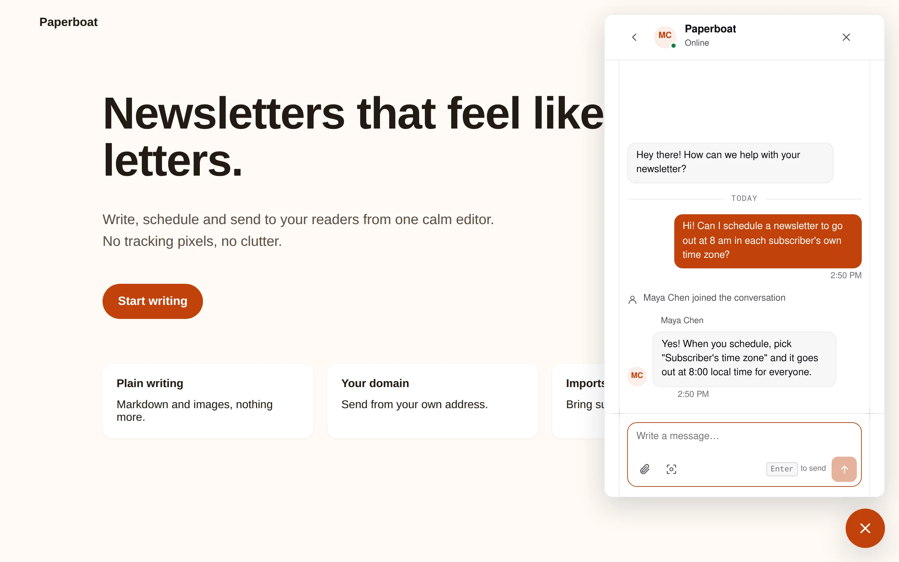

<div align="center">


# Yuva

**One inbox for every product you run.**

[Website](https://useyuva.com) · [Docs](docs/install.md) · [API](openapi/openapi.yaml) ·
[Releases](https://github.com/productdevbook/yuva/releases) · [Roadmap](docs/roadmap.md) ·
[X](https://x.com/useyuva)

[](https://github.com/productdevbook/yuva/releases)
[](https://github.com/productdevbook/yuva/actions/workflows/ci.yml)
[](LICENSE)
[](sdk/LICENSE)

</div>

Yuva is open-source customer messaging for teams that run several products. Support e-mail, live
chat, in-app messages and feedback from every product land in one shared inbox, next to the
newsletters, help center, status pages and analytics you send and publish from the same place.

You host it yourself: one Docker image and Postgres.

<picture>
  <source media="(prefers-color-scheme: dark)" srcset=".github/assets/panel-dark.webp">
  
</picture>

> [!WARNING]
> **Pre-alpha.** The API and database schema can change without migration paths, and the code has
> not had an independent security audit. Try it with test data, not real customer conversations.

## Features

**Conversations**

- One inbox per product, each with its own branding, language, hours and team.
- [E-mail](docs/email.md), [live chat](docs/widget.md) and [in-app messages](docs/mobile.md) in one
  conversation, with attachments, notes, labels, canned replies and @mentions for teammates.
- [Feedback](docs/mobile.md) from your apps, with progress (planned, in progress, done) the sender
  can follow.
- Bots and assistants write [drafts](docs/headless.md#a-bot-that-answers-with-drafts) that a member
  reviews and sends.

**Reach**

- [Mailing lists](docs/lists.md) with consent records, [imports](docs/importing.md) and exports.
- [E-mail designs](docs/designs.md) built from blocks and a theme, starting from the templates that ship with Yuva.
- [Broadcasts](docs/broadcasts.md) with scheduling, approval and reports, and a
  [deliverability check](docs/deliverability.md) for your sending domain.

**Help and publishing**

- [Help center](docs/help-center.md) with search and a report of what readers look for.
- [Documentation pages](docs/documentation-pages.md) with discussions and "Was this page helpful?".
- [Status pages](docs/status-pages.md) with components, incidents, heartbeats, e-mail subscribers
  and your own domain.
- [Roadmap board](docs/roadmap-board.md) with votes, and [What's new](docs/whats-new.md) for release
  notes.

**Insights**

- [Cookieless analytics](docs/analytics.md) for websites and apps, with a
  [support report](docs/analytics-support.md) that ranks pages by the conversations they cause.

**Move to Yuva**

- [Migrations](docs/migrate.md) of mail history and then live mail from Gmail, Google Workspace,
  Outlook and Microsoft 365, Yandex, iCloud, Zoho, Yahoo, Fastmail, GMX, any IMAP server, Zendesk
  and Help Scout. The old mailbox is only read.

**Build on it**

- A REST [API](openapi/openapi.yaml) with scoped keys, signed [webhooks](docs/webhooks.md), an event
  feed and [identity tokens](docs/identity.md) for your signed-in users.
- [Headless](docs/headless.md) mode: use the API without the panel.
- An [MCP server](docs/mcp.md) with OAuth, so Claude, Cursor, VS Code and other assistants can triage
  the inbox, draft replies, set up channels and read analytics.

<table>
  <tr>
    <td width="50%">
      <picture>
        <source media="(prefers-color-scheme: dark)" srcset="site/src/assets/shots/panel-broadcast-en-dark.webp">
        
      </picture>
    </td>
    <td width="50%">
      <picture>
        <source media="(prefers-color-scheme: dark)" srcset="site/src/assets/shots/panel-analytics-en-dark.webp">
        
      </picture>
    </td>
  </tr>
  <tr>
    <td colspan="2" align="center">
      <picture>
        <source media="(prefers-color-scheme: dark)" srcset="site/src/assets/shots/widget-en-dark.webp">
        
      </picture>
    </td>
  </tr>
</table>

## Quick start

1. Write `compose.yaml` and `.env` from the [install guide](docs/install.md#quick-start-with-compose).
2. Start it:

   ```sh
   docker compose up -d
   ```

3. Create the first owner:

   ```sh
   docker compose exec yuva /yuva bootstrap --email you@example.com --workspace "Example"
   ```

4. Put it behind HTTPS and sign in with the code that arrives by e-mail.

On Kubernetes, install the Helm chart `oci://ghcr.io/productdevbook/charts/yuva`; see
[Kubernetes with Helm](docs/install.md#kubernetes-with-helm).

## SDKs and clients

| For | Install | Guide |
|---|---|---|
| Web: `<yuva-chat>`, headless client | `npm install useyuva` | [Web widget](docs/widget.md), [Headless](docs/headless.md) |
| React and shadcn/ui | `npx shadcn@latest add https://useyuva.com/r/yuva-discussions.json` | [shadcn registry](sdk/shadcn/README.md) |
| iOS and macOS | Swift package `https://github.com/productdevbook/yuva.git`, product `YuvaKit` | [Mobile SDKs](docs/mobile.md) |
| Android | `implementation("com.github.productdevbook:yuva:v0.0.32")` | [Mobile SDKs](docs/mobile.md) |
| Go | `go get github.com/productdevbook/yuva/sdk/go` | [Go SDK](sdk/go/README.md) |
| AI assistants | `/mcp` on your server, or `yuva.mcpb` from a release | [MCP](docs/mcp.md) |

Working projects are in [examples](examples).

## Privacy and security

- You host it: conversations, contacts and files stay on your servers.
- Analytics set no cookies and keep no cross-site identifiers; see
  [analytics privacy](docs/analytics-privacy.md).
- Every subscription records who consented, when and where, and lists export with that record.
- For assistants, customer text is marked as untrusted data, and their replies are drafts unless you
  allow sending.
- Report vulnerabilities privately as described in [SECURITY.md](SECURITY.md).

## Documentation

| | |
|---|---|
| **Run it** | [Install](docs/install.md) · [Configuration](docs/configuration.md) · [Operations](docs/operations.md) |
| **Conversations** | [E-mail](docs/email.md) · [Web widget](docs/widget.md) · [Mobile SDKs](docs/mobile.md) · [Identity tokens](docs/identity.md) |
| **Reach** | [Mailing lists](docs/lists.md) · [Importing](docs/importing.md) · [Designs](docs/designs.md) · [Broadcasts](docs/broadcasts.md) · [Deliverability](docs/deliverability.md) |
| **Publish** | [Help center](docs/help-center.md) · [Documentation pages](docs/documentation-pages.md) · [Status pages](docs/status-pages.md) · [Roadmap board](docs/roadmap-board.md) · [What's new](docs/whats-new.md) |
| **Analytics** | [Overview](docs/analytics.md) · [Apps](docs/analytics-apps.md) · [Events](docs/analytics-events.md) · [Consent](docs/analytics-consent.md) · [Privacy](docs/analytics-privacy.md) · [Sharing](docs/analytics-sharing.md) |
| **Move** | [Move to Yuva](docs/migrate.md) · [Files](docs/migrate-files.md) · [Operators](docs/migrate-operators.md) |
| **Build** | [Headless](docs/headless.md) · [Webhooks](docs/webhooks.md) · [MCP](docs/mcp.md) · [API contract](openapi/openapi.yaml) · [Examples](examples) |
| **Project** | [Architecture](docs/architecture.md) · [Roadmap](docs/roadmap.md) · [Changelog](CHANGELOG.md) |

The guides are also in [Turkish](docs/tr) and [German](docs/de).

## Community and contributing

Read [CONTRIBUTING.md](CONTRIBUTING.md) first; contributions are made under the [CLA](CLA.md).
Ask questions and report bugs in [issues](https://github.com/productdevbook/yuva/issues), and follow
[@useyuva](https://x.com/useyuva) for news.

## License

The server and panel are [AGPL-3.0](LICENSE). The SDKs (`sdk/`) and the API contract (`openapi/`)
are [MIT](sdk/LICENSE), so you can ship them in closed-source apps. Details in
[LICENSING.md](LICENSING.md); name and logo in [TRADEMARK.md](TRADEMARK.md).

<div align="center">
<sub>“Yuva” is Turkish for nest, or home.</sub>
</div>
