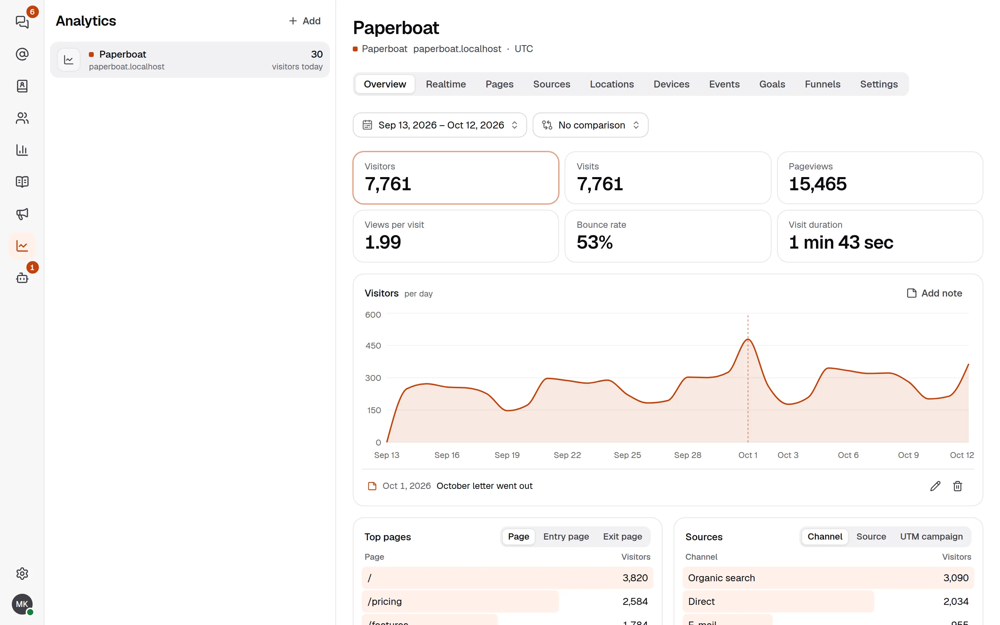
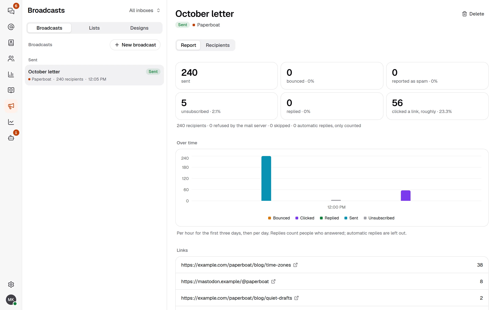
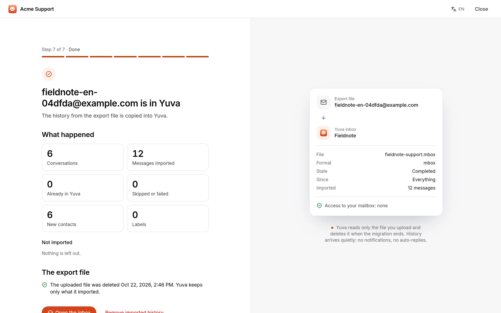

Since [the first post](/blog/introducing-yuva/), we have shipped [version 0.0.9](https://github.com/productdevbook/yuva/releases/tag/v0.0.9). The inbox is still the centre of Yuva, but the same workspace now does three more things that small teams usually buy separately: it counts the visitors of your websites, it sends your newsletters, and it brings your existing mail and support history over so you do not start from an empty room.

## Analytics without cookies

Yuva Analytics counts the visitors, pages, sources, places and devices of your own websites, and it lives in the same panel as your inbox. One script tag on your pages is all it takes, and there are components for React, Next.js, Nuxt, Vue and Astro too.

What you get:

- **Overview, pages, sources, locations and devices**, with filters, a comparison with the previous period and CSV export.
- **Realtime**: who is on the site right now.
- **Events** you send yourself, with props and **revenue**, so you can see what a campaign earned.
- **Goals and funnels**, to see where people drop out.
- **Segments**, to save a filter and come back to it.
- **Notes on charts**, such as "October letter went out", so a spike explains itself later.

What it does not do matters as much. It sets no cookies and writes nothing to the visitor's device. The IP address is shortened before anything else uses it, the place is looked up from the shortened address, and no address is stored. A visitor is a hash that is the same only within one day on one site, under a salt that is deleted soon after the day ends. Browsers that send Do Not Track or Global Privacy Control are not counted at all, and that cannot be switched off. Whether you still need a banner depends on where your visitors are; [Analytics and privacy](/docs/analytics-privacy/) says what is kept, for how long, and gives text for your privacy notice. It is information, not legal advice.

Read the [analytics guide](/docs/analytics/) to add a website, and [events and goals](/docs/analytics-events/) to send your first event.

## Newsletters to people who agreed

The same workspace can now write to your lists. A [mailing list](/docs/lists/) holds the people who agreed to hear from you: visitors join with a subscribe form, your backend adds people it already has consent for, and every change goes into a consent log you can export.

You build the mail in the [designer](/docs/designs/), or start from one of six templates, each in English, Turkish and German. The server turns it into mail HTML that works in common mail apps, with a plain-text part and a dark mode. When you [send the broadcast](/docs/broadcasts/), the report shows what happened: how many were sent, unsubscribed or clicked, a chart over time, and the clicks per link.

Reaching the inbox is mostly about set-up, so Yuva has a [deliverability check](/docs/deliverability/) for each e-mail channel that tests SPF, DKIM and DMARC and tells you what to fix. Broadcasts carry one-click unsubscribe headers (`List-Unsubscribe`, RFC 8058).

## Moving in

Most teams already have years of support mail somewhere. The [migration guide](/docs/migrate/) brings that history into a Yuva inbox from Gmail and Google Workspace, Outlook and Microsoft 365, Yandex, iCloud, Zoho, any IMAP server, Zendesk and Help Scout, or from an export file (Google Takeout, mbox, .eml or Maildir in a zip).

Yuva only reads at the source. Nothing in the old mailbox is changed or deleted, and your team keeps working while the history is copied. Imported history arrives quietly, with no notifications and no automatic replies, and when you are ready you switch delivery over to Yuva. An export file is deleted when the migration ends.

## Try it

The release notes are on [GitHub](https://github.com/productdevbook/yuva/releases/tag/v0.0.9).

- **Hosted:** create an account from the [home page](/) and start without running a server.
- **Self-hosted:** run the Docker image `ghcr.io/productdevbook/yuva:0.0.9` with Postgres. The [quick start](/docs/install/) has the Compose file.

Yuva is still pre-alpha: the API and the database schema can change without migration paths, and the code has not had an independent security audit. Try it with test data, and tell us what breaks in an [issue](https://github.com/productdevbook/yuva/issues).
